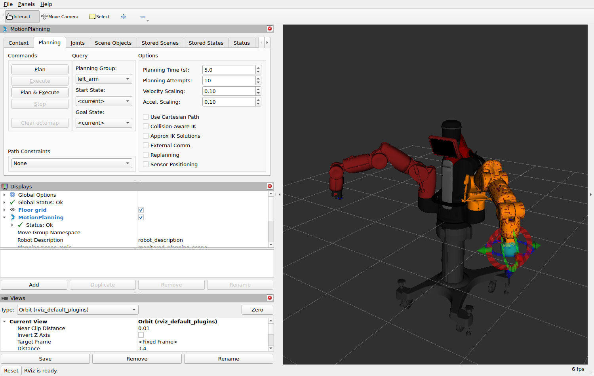

# Planned motions: MoveIt

`Limb.move_to_joint_positions()` and `Limb.move_to_pose()` move an arm straight to its
target; if something is in the way, the robot's own collision avoidance stops the arm.
MoveIt looks for a path first: one on which the arm touches neither the rest of the
robot nor the things you tell it about. Then it moves along that path.

```
RViz panel or your program  ->  MoveIt (move_group)  ->  joint trajectory action server  ->  bridge  ->  robot
        "hand to here"            finds a path,              makes the arm follow
                                  times it                   the timed path
```

The action server is the library's ([trajectory-action.md](trajectory-action.md));
MoveIt's start file starts it.

## Start

MoveIt 2 runs on a computer with ROS 2 and MoveIt installed (the lab machines have both),
or in a container of its own.

**With MoveIt installed:** `scripts/setup.sh` builds the MoveIt configuration when it
finds MoveIt (`sudo apt install ros-<distro>-moveit`, then run `setup.sh` again). With the
bridge running and the robot enabled:

```bash
source ~/baxter_ws/baxter.sh
ros2 launch baxter_moveit_config moveit.launch.py
```

**In the container:**

```bash
xhost +local:docker              # once per login, as for RViz; not on WSL2
docker compose run --rm moveit   # downloads the image (about 1 GB) the first time
```

Arguments for the start file go after `ros2 launch` in both cases; in the container:
`docker compose run --rm moveit ros2 launch baxter_moveit_config moveit.launch.py <arguments>`.
The commands on the rest of this page are written for an installed MoveIt.

A window opens: RViz with the robot and the "MotionPlanning" panel.



1. In the panel's "Planning" tab, choose the **Planning Group**: `left_arm`,
   `right_arm` or `both_arms` (the start).
2. Drag the coloured ball and rings at the hand: the orange arm is where the arm is to
   go. If it turns red, that posture touches something.
3. **Plan** shows the motion. **Execute** runs it on the robot. **Plan & Execute** does
   both.
4. "Velocity Scaling" and "Accel. Scaling" are the share of the top speed. They start at
   0.1, and that is where they should stay (see "Speeds").

**Plan**, then **Execute** later, runs the plan from where it starts. If the arm has
moved more than 0.1 rad (6°) since, MoveIt refuses ("start point deviates from current
robot state"): plan again. **Plan & Execute** plans from where the arm is.

**Execute moves the real arm.** Someone at the e-stop, nobody within reach, as with every
program that moves the robot.

With Rethink's electric grippers mounted, MoveIt has to know: see "Grippers".

## From a program

Start MoveIt without the window, and leave it running:

```bash
ros2 launch baxter_moveit_config moveit.launch.py rviz:=false
```

Then, in another terminal (also set up with `baxter.sh`):

```bash
python3 ~/baxter-ros2-bridge/examples/17_moveit.py
```

In the container, a program that uses MoveIt has to run in the MoveIt container too,
because only that image has MoveIt's message types:
`docker compose run --rm moveit python3 examples/17_moveit.py`.

```python
from baxter_interface.planning import MotionPlanner, PlanningError

planner = MotionPlanner()

# Things in the room the arms must not touch: size and centre in metres, in the robot's
# base frame.
planner.add_box('table', size=(0.8, 1.6, 0.05), position=(0.8, 0.0, -0.25))

planner.move_to_named('both', 'neutral')                  # both arms, one plan
planner.move_to_pose('left', position=(0.7, 0.3, 0.1))    # hand to a place
planner.move_to_joint_positions('right', {'right_w1': 0.5})

plan = planner.move_to_pose('left', (0.6, 0.5, 0.3), plan_only=True)   # only look
print(plan.points, 'points,', plan.duration, 's')

try:
    planner.move_to_pose('left', (3.0, 0.0, 0.0))
except PlanningError as error:
    print(error)       # "... no path was found; the target may be out of reach ..."
```

- `move_to_pose(limb, position, orientation=None)`: the pose means the same
  hand tip as `Limb.hand_position()`. Without an orientation the hand stays turned as it
  is.
- `move_to_joint_positions(limb, positions)`: `limb` may be `'both'`; joints you leave
  out may end anywhere.
- `move_to_named(limb, 'neutral')`.
- Every move takes `plan_only=True` (plan, show in RViz if it is open, do not move),
  `speed` and `acceleration` (0 to 1, see "Speeds") and `planning_time` (seconds per
  try, default 5).
- `add_box(name, size, position, orientation)`, `remove_object(name)`,
  `clear_objects()`.
- A move returns `Plan(joints, points, duration)` and raises `PlanningError` with the
  reason when no path is found or the motion fails. A search that finds nothing is
  tried up to three times: the planner searches at random, and the next search may
  find a path.

The library's ordinary commands still work next to it: `Limb('left').joint_angles()`,
grippers, the head.

## What MoveIt knows about the robot, and what it does not

- **The robot itself:** from the robot's own robot model (see "The robot model"). Arms,
  head, screen, torso and pedestal are checked against each other.
- **Rethink's electric gripper: known if you say it is mounted** (see "Grippers" below).
  Then its body and fingers are kept clear of everything, like the rest of the arm.
- **Other grippers, and anything held: not known.** The robot model then ends at the
  hand's mounting plate. A mounted gripper is taken into account for *where the hand tip
  is* (the library measures the difference), but MoveIt does not know its shape and may
  plan a path on which the gripper touches something. Leave room, or add a box around it.
- **The room: only what you add** with `add_box()`. MoveIt has no camera or sensor input
  here. An empty scene means "nothing but the robot".
- **Other robots: not known.** With several robots ([two-robots.md](two-robots.md)),
  start one MoveIt per robot (`robot:=one`, or `--env-file .env.one` for the container);
  each plans for its robot alone.
- **The Mobility Base: not part of the model.** Planning assumes the robot stands still.

## The robot model

MoveIt plans with **the robot's own robot model**, as the original configuration does.
Every Baxter keeps its model in the ROS 1 parameter `/robot_description`, and it is not
quite the general one of `baxter_common`: the points where the arms are mounted are
measured for each robot. On robot 1 they differ from the general model by about 1 cm in
height and up to 0.6° in angle, which moves the hand by up to about 1 cm; the robot's
model also has simpler collision shapes for torso and pedestal, and the head's limits are
±80° instead of ±90°.

The bridge passes the model on as the ROS 2 topic `robot/robot_description`
(`docker/bridge-jazzy/robot_model.py`), and MoveIt waits up to 30 s for it at its start
("Waiting for the robot's own robot model"). If it does not come, check that the bridge
is running.

Other models, for one start:

```bash
ros2 launch baxter_moveit_config moveit.launch.py robot_model:=generic          # baxter_common's, the same for every robot
ros2 launch baxter_moveit_config moveit.launch.py robot_model:=/path/my.urdf    # a file of your own
```

## Grippers

MoveIt has to be told which arms carry Rethink's electric gripper. In `.env` (with
several robots, the robot's own file):

```bash
LEFT_ELECTRIC_GRIPPER=1
RIGHT_ELECTRIC_GRIPPER=1
```

`baxter.sh` passes these on to the terminal (source it again after a change), and the
MoveIt container reads them from the settings file. For one start only:

```bash
ros2 launch baxter_moveit_config moveit.launch.py left_electric_gripper:=true right_electric_gripper:=true
```

The setting chooses which pairs of the gripper's parts are never checked against each
other (as the original's `left_electric_gripper` / `right_electric_gripper`; both off by
default, as in its usual start, `demo_baxter.launch`). The gripper's shape comes from the
robot model:

- **The robot's own model** has a mounted electric gripper in it: the robot adds it
  itself. Without the setting, MoveIt warns at its start ("... the robot's model has an
  electric gripper on the left arm ...") and refuses every plan, because it takes the
  gripper's own parts for a collision (`START_STATE_IN_COLLISION`). The other way round,
  a setting without a gripper in the model, MoveIt warns too and does not know the
  gripper's shape.
- **With `robot_model:=generic`** MoveIt uses Rethink's model of the gripper (from
  `baxter_common` v1.2.0).

With the gripper in the model, its body and both fingers are checked for collisions, and
the hand tip, `left_gripper` / `right_gripper`, is at the tip of the fingers, as on the
robot. The fingers are drawn where the robot reports them, open or closed; MoveIt does
not open or close them (use `Gripper` from the library for that).

With `robot_model:=generic` the fingers are Rethink's default: the long narrow fingers
("extended narrow") in slot 2, with paddle tips. Other fingers are other shapes and
lengths; give them at the start, with the names of the files in
`urdf/rethink_ee/electric_gripper/fingers` of the robot model:

```bash
ros2 launch baxter_moveit_config moveit.launch.py robot_model:=generic left_electric_gripper:=true finger:=standard_narrow finger_slot:=1 finger_tip:=basic_soft_tip
```

Both grippers get the same fingers. Say a gripper is mounted only when it is: MoveIt then
keeps a gripper that is not there clear of things, which costs room but nothing else; the
other way round, a mounted gripper it does not know can hit things.

## Two planners

As in the original, two planners are loaded:

- **OMPL** (the default) searches at random for a path and finds its way around things.
- **CHOMP** starts from the straight line between start and goal and bends it away from
  things: smooth paths, but no way around a large obstacle. Its settings are the
  original's (`config/chomp_planning.yaml`). It takes **joint angles only** as a target:
  RViz's panel sends those, and from a program `move_to_joint_positions` and
  `move_to_named` work; `move_to_pose` is refused ("CHOMP takes only joint angles"), as
  it was in MoveIt 1.

In RViz, the panel's "Context" tab chooses the planner. For a whole start:

```bash
ros2 launch baxter_moveit_config moveit.launch.py planner:=chomp
```

`MotionPlanner` uses the one chosen at the start.

## Speeds

How fast a planned motion runs is set as two shares from 0 to 1: `speed` of each joint's
top speed, `acceleration` of its top acceleration, which decides how sharply a motion
starts and stops. Both start at 0.1, in RViz's panel (its two "Scaling" fields) and in
the library. From a program:

```python
from baxter_interface import settings

planner.move_to_pose('left', (0.7, 0.3, 0.1), speed=0.2)   # this move only

settings.PLANNING_SPEED = 0.2          # every move from here on
settings.PLANNING_ACCELERATION = 0.2
```

**On the real robot, only 0.1 runs cleanly.** At 0.3 and above the joint trajectory
action server stops motions part of the way, because a joint falls more than 0.2 rad
behind the plan (for example "right_s1 is 0.202 rad away from the path"): the elbows with electric
grippers mounted, the shoulder (`s1`, which carries the arm's weight) in large motions
without them. Nothing breaks, but it is a rough stop, so raise the shares in small steps
if at all.

What 1.0 means is written in `moveit_config/config/joint_limits.yaml`. The values are
those of the configuration Rethink Robotics and MoveIt shipped for Baxter (see "The
original configuration" below):

| | Top value |
| --- | --- |
| Speed, every joint | 3.0 rad/s |
| Acceleration, every joint | 3.0 rad/s² |

The speed is above the robot model's own limits (1.5 rad/s for shoulder and elbow, 4.0
for the wrist), so at 0.5 a shoulder motion is already at its limit. The action server's
limits (0.2 rad from the path, 0.25 rad/s at the end) are those of Rethink's own action
server. The top acceleration can be changed for one start without editing the file:

```bash
ros2 launch baxter_moveit_config moveit.launch.py acceleration_limit:=2.0
```

## The original configuration

Rethink Robotics and MoveIt shipped a MoveIt configuration for Baxter for ROS 1
(`baxter_moveit_config` 1.1.1 in `moveit_robots`). It is no longer online; the lab's
workstation had it, and a copy is kept unchanged in
`moveit_config/reference/moveit_robots_baxter/` (BSD licence; the folder is not built).

Taken over from it:

| What | Where it is now |
| --- | --- |
| Planning groups (`left_arm`, `right_arm`, `both_arms`, `left_hand`, `right_hand`), end effectors, the postures `left_neutral` and `right_neutral` | `config/baxter.srdf.in` |
| The pairs of parts that are not checked against each other: 272 without gripper, and those of the electric gripper for an arm that has it | `config/baxter.srdf` and `config/baxter_*gripper*.srdf`, made by `scripts/make_srdf.py` |
| Speed and acceleration limits | `config/joint_limits.yaml` |
| Inverse kinematics settings (KDL, a 5 ms time limit) | `config/kinematics.yaml` |
| Planner settings per arm, except how finely a path is checked (see below) | `config/ompl_planning.yaml` |
| How much longer than planned a motion may take before MoveIt gives up (50 times, plus 20 s), and how far the arm may be from a plan's start when it is run (0.1 rad) | `launch/moveit.launch.py` |
| The robot's own robot model (the original's usual start does not load one and uses the robot's) | the bridge (`docker/bridge-jazzy/robot_model.py`) and `launch/moveit.launch.py` |
| The electric gripper on either arm (the original's `left_electric_gripper` / `right_electric_gripper`, off as in its `demo_baxter.launch`) | `launch/moveit.launch.py`; with `robot_model:=generic` the robot model's `xacro/baxter_grippers.urdf.xacro` |
| A start posture up to 0.1 rad past a joint's limit is put on the limit (`start_state_max_bounds_error`) | `scripts/joint_states_for_moveit.py` (MoveIt 2 no longer does it) |
| CHOMP as a second planner, with its settings | `config/chomp_planning.yaml` |
| The 3D map's resolution (0.02 m; used once a depth camera feeds one) | `launch/moveit.launch.py` |
| The motion planning panel's settings (start group `both_arms`, 10 attempts, 5 s, colours, the robot drawn half see-through) | `rviz/moveit.rviz` |

Added here: the posture `both_neutral`, and 6 pairs of parts that overlap in the robot
model in postures the original did not meet (each with its reason in `baxter.srdf.in`).
Written differently, same value: CHOMP's `pseudo_inverse_ridge_factor` is `1.0e-4` (the
original's `1e-4` is read as text, and MoveIt 2.15 refuses it).

Not taken over, by choice: the IKFast solvers for both arms (switched off in the
original too); the depth cameras (Kinect, Xtion) and their settings; the "floating" joint
between the room and the robot, which matters only for a robot that moves; the database
of saved plans; the start without a robot ("fake" controllers); the example scene
`baxter_pillar.scene`.

Not possible, because MoveIt 2 (Jazzy) no longer has it: `kinematics_solver_attempts`;
nudging a start posture that touches something free (`FixStartStateCollision`,
`jiggle_fraction`) and `max_safe_path_cost`; the original's way of timing a path
(iterative parabolic; MoveIt 2 has the time-optimal one); CHOMP's settings for
animation and Hamiltonian Monte Carlo; Pick & Place. Execution margins per arm: the
original sets them per arm (50 times plus 20 s) and once more for all (1.5 times plus
1 s); here they are set once, to the per-arm values.

**One value deliberately not the original's:** how finely a path is checked for
collisions (`longest_valid_segment_fraction` in `ompl_planning.yaml`). The original
checks only at widely spaced points (0.05); here it is MoveIt 2's own default, 0.005, ten
times finer. With the original's value an arm moves so far between two checks that an
object falls in between, and the planner finds a path *through* it. MoveIt 2's final
check refuses such a path ("Computed path is not valid ... contact between 'wall' and
'left_hand'"); MoveIt 1, for which the original was made, had no such final check and
would have run it. In tests with a 2 cm and a 10 cm thick wall between hand and target,
0.05 found no path (every try went through the wall); 0.005 found both.

## How it is put together

| Part | Where |
| --- | --- |
| MoveIt configuration (ROS 2 package `baxter_moveit_config`) | `moveit_config/` |
| Planning groups, named postures, pairs of parts that are not checked | `moveit_config/config/baxter.srdf` (and one file per choice of grippers), made from `baxter.srdf.in` and the original configuration by `scripts/make_srdf.py` |
| The robot's own robot model, passed on from ROS 1 | `docker/bridge-jazzy/robot_model.py` (topic `robot/robot_description`) |
| The general robot model with electric grippers (`robot_model:=generic`) | `robot_model/xacro/baxter_grippers.urdf.xacro`; Rethink's gripper model is fetched with the robot's by `robot_model/fetch_model.sh` |
| Start file | `moveit_config/launch/moveit.launch.py` |
| Image | `docker/moveit-jazzy/` |
| The class | `baxter_interface_ros2/baxter_interface/planning.py` |

Three things had to be worked around, and each is explained where it is done:

- **Time stamps.** The robot stamps its joint angles with its own clock, and MoveIt
  ignores data that does not look recent by this computer's clock. A small helper
  (`scripts/joint_states_for_moveit.py`) passes the joint angles on with this computer's
  time. It also puts a joint that rests a hair past its limit onto the limit, which
  MoveIt would otherwise refuse to plan from.
- **Overlapping shapes in the robot model.** Some parts of Baxter's model overlap in
  ordinary postures (the arm's outer shells, the head's extra shapes, the shoulder when
  the arm hangs). The original configuration switches most of those pairs off;
  `baxter.srdf.in` adds the few it misses and says why.
- **The hand tip.** See "Grippers" above.

## Limitations

- Keep both speed shares at 0.1 on the real robot (see "Speeds").
- MoveIt may end with a "Segmentation fault" when stopped with Ctrl+C: a known fault of
  MoveIt 2 Jazzy while shutting down, after everything else has stopped. It does no harm.
- Run with Fast DDS only (`baxter.sh` sets it); not tried with Cyclone DDS in the
  terminal.
- Not tested yet: planning with both arms around an object, and long sessions.
