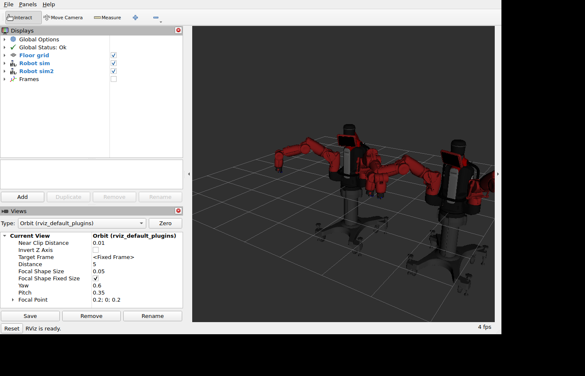

# Seeing the robot in 3D: RViz 2

RViz is ROS's 3D viewer. With Baxter's robot model it shows the robot on your screen in
the posture the real robot is in, live. It is the easiest way to check what a program
does, and the base for adding camera pictures, sensor data or planned paths later.

How it works: the robot reports its joint angles (`/robot/joint_states`, through the
bridge). A program called `robot_state_publisher` combines them with the **robot model**,
a file that describes Baxter's parts and how they are joined, and RViz draws the result.

The model and its 3D shapes (about 35 MB) are Rethink Robotics' `baxter_description`
v1.2.0. They are not stored in this repository; `robot_model/fetch_model.sh` downloads
them from Rethink's GitHub at a fixed commit.

## On a computer with ROS 2 installed

`scripts/setup.sh` builds the model into `~/baxter_ws` (and installs `rviz2` and
`robot_state_publisher` if they are missing). With the bridge running, on this or another
computer ([own-machine.md](own-machine.md)):

```bash
source ~/baxter_ws/baxter.sh
ros2 launch baxter_description view_robot.launch.py
```

A window opens with the robot. Drag with the left mouse button to turn the view, with the
middle button to shift it, and use the wheel to zoom. On the lab machines and in WSL the
window opens on the Windows desktop.

`robot_model/` is the ROS 2 package `baxter_description`: the downloaded model plus a
launch file and an RViz configuration.

## With Docker

Without ROS 2 installed, RViz runs in a container. It needs a Linux computer with a
screen (the window opens on the computer Docker runs on):

```bash
xhost +local:docker              # once per login: lets the container open a window (not on WSL2)
docker compose run --rm rviz     # downloads the image the first time
```

By default the container draws without the graphics card's own driver, which is slower
and keeps several processor cores busy, but works everywhere, including in a virtual
machine. On a computer with a working graphics driver, `RVIZ_SOFTWARE_RENDERING=0` in
`.env` switches that off. On WSL2 the line `COMPOSE_FILE=compose.yaml:compose.wsl-gpu.yaml`
in `.env` does it instead: it passes Windows' graphics driver into the container.

## What you see, and what you can add

The configuration shows the robot and a floor grid. In RViz's "Displays" panel, "Add"
offers more; "Frames" (already in the list, switched off) shows the coordinate frames of
all parts.

The positions of the robot's parts are published on `/baxter_model/tf` and
`/baxter_model/tf_static`, not on the usual `/tf`. The reason: the robot publishes a
`/tf` of its own, and the bridge would carry ours to the robot and mix the two. A program
of yours that wants the transforms listens to those two topics (in a launch file: remap
`/tf` and `/tf_static`, as `robot_model/launch/view_robot.launch.py` does for RViz).

The model shows the robot without grippers.

## A robot with a name, and several robots in one picture

With several robots, each has a name ([two-robots.md](two-robots.md)). Started with a
robot's settings file, RViz shows that robot:

```bash
docker compose --env-file .env.one run --rm rviz
```

(With ROS 2 installed: `ros2 launch baxter_description view_robot.launch.py robot:=one`.
The transforms are then on `/one/baxter_model/tf`.)

All robots in one picture, each where it stands in the room:

```bash
docker compose --env-file .env.one run --rm rviz ros2 launch baxter_description view_robots.launch.py
```



It shows every robot whose bridge is running at that moment (either settings file will
do), or the ones you name: `... view_robots.launch.py robots:="one two"`.

- **Frames:** every coordinate frame has its robot's name in front: `one/base`,
  `one/left_gripper`, `two/base`. All of them are on `/baxter_model/tf` and
  `/baxter_model/tf_static`.
- **Where the robots stand:** the robots do not know. `ROBOT_POSITION` in each robot's
  settings file says it: `x y z turn`, in metres from a point you choose and degrees
  around the vertical axis (counter-clockwise seen from above; x is forward, y to the
  left). Each robot's bridge passes it on as the transform from the frame `world` to
  that robot's base. Without the line, all robots stand on the same spot. After
  changing it, restart that robot's bridge. The picture is only as right as the numbers
  you measured.

## If the window does not open

- `Authorization required` or `could not connect to display`: run `xhost +local:docker`
  in a terminal on the machine's desktop (not over SSH), then try again.
- Over SSH there is no screen: run the command in a terminal on the machine itself.
- Only the torso and the stand are drawn, the arms are missing, and "Robot" in the
  Displays panel shows an error: no joint angles arrive. Is the bridge running, and
  `ROS_DOMAIN_ID` the same?

## Limitations

- Not tested yet: RViz on a computer other than the bridge's, and several real robots in
  one picture (the picture above is from two simulated robots).
